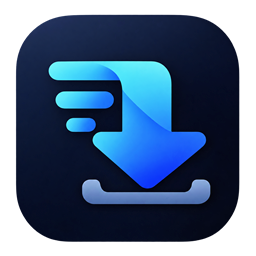
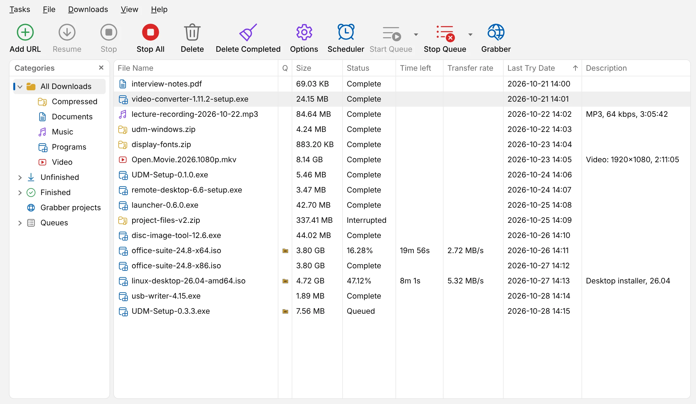
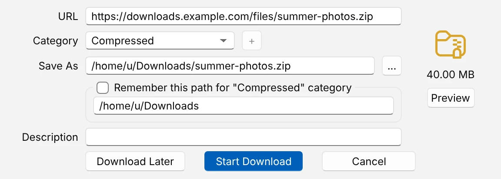
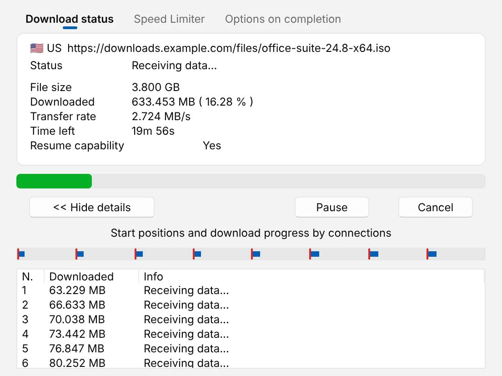
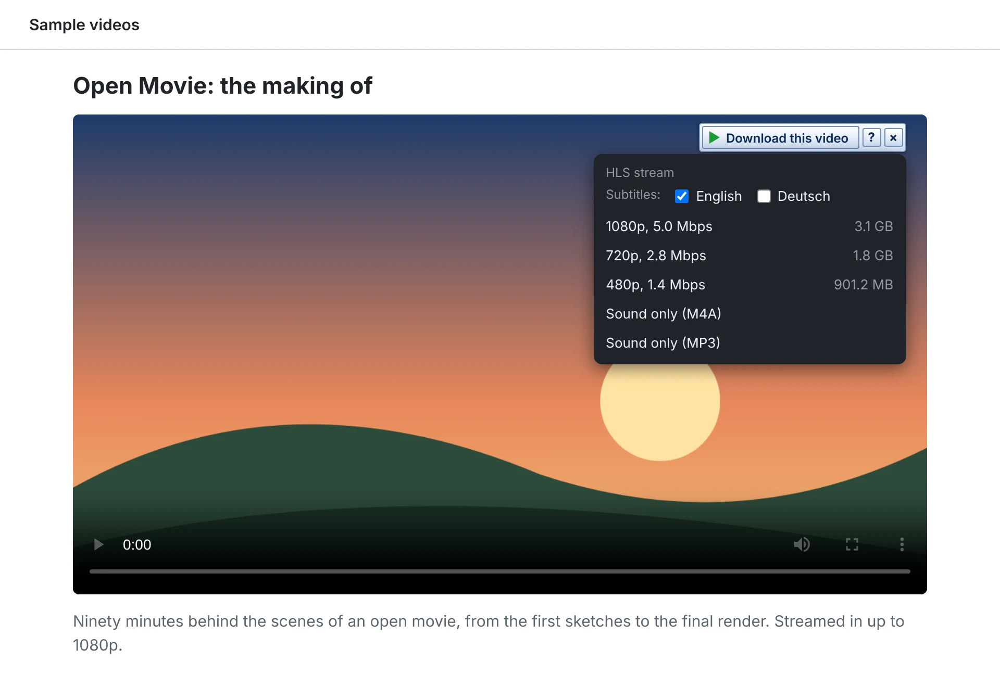
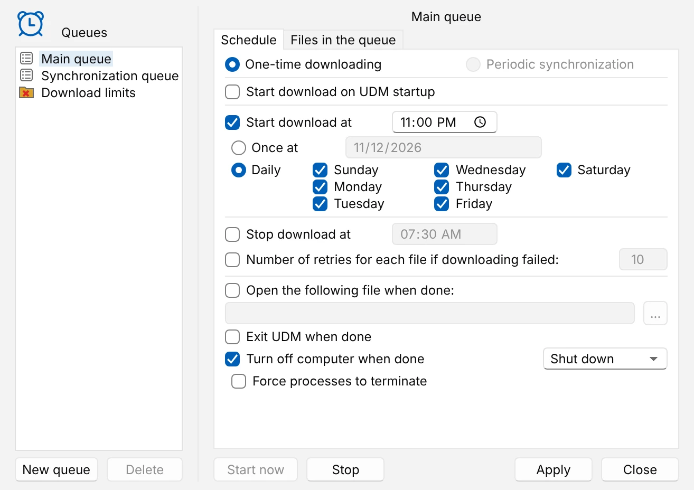
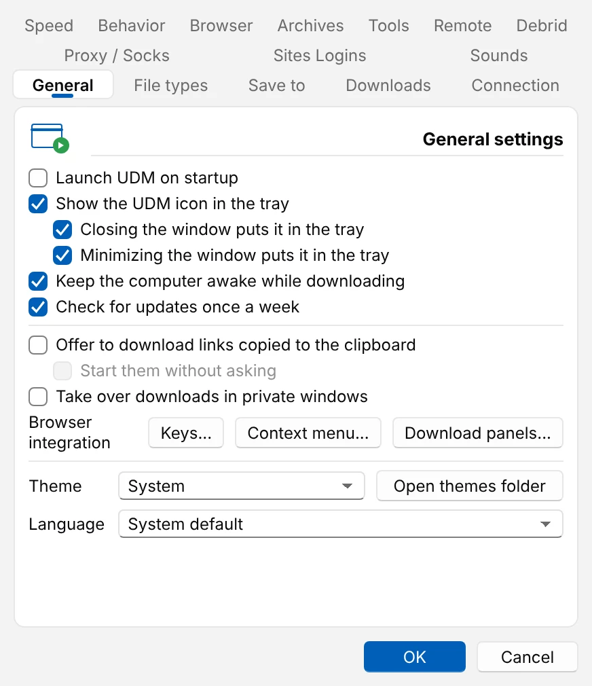
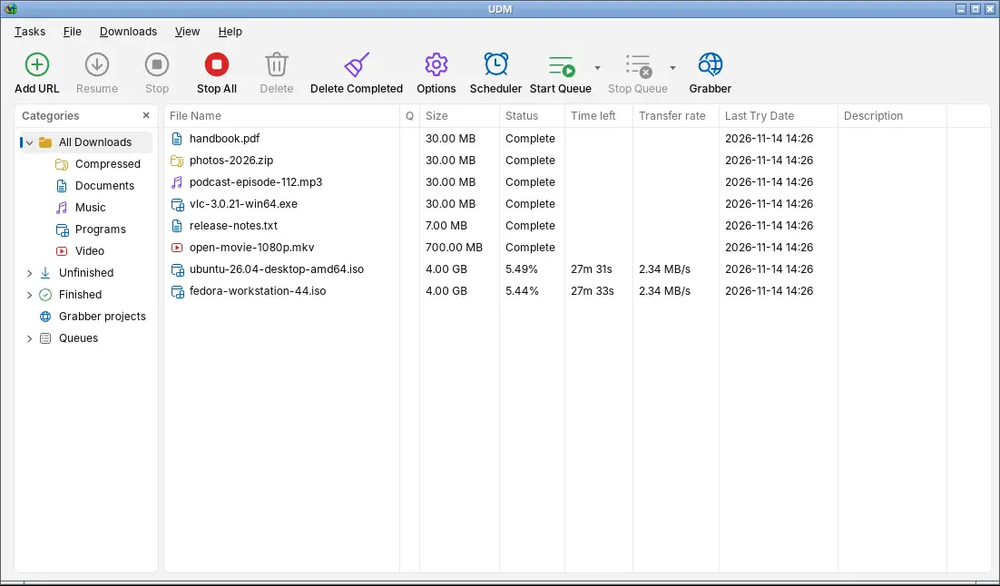

# UDM: free, open-source IDM alternative for Windows, macOS and Linux

<p align="center">
  
</p>

<h3 align="center">The download manager you know from IDM. On Windows, macOS and Linux. Free.</h3>

<p align="center">
  UDM (Unified Download Manager) is a fast download manager and video downloader, written in Rust.
  It uses up to 16 connections per file, resumes after interruptions, and catches downloads from your browser.
  <br><a href="https://tajbinkhan.github.io/UDM/">tajbinkhan.github.io/UDM</a>
</p>

<p align="center">
  <a href="https://github.com/tajbinkhan/UDM/releases/latest"></a>
  <a href="https://github.com/tajbinkhan/UDM/releases/latest"></a>
  <a href="https://github.com/tajbinkhan/UDM/releases/latest"></a>
</p>

<p align="center">
  🧩 <b>Browser extension</b> for Chrome, Edge, Brave, Vivaldi, Opera and Firefox, in every download
  (<a href="docs/install.md#windows">how to add it</a>).
</p>

<p align="center">
  <a href="https://github.com/tajbinkhan/UDM/stargazers"></a><br>
  <sub>⭐ <b>Like it? Give it a star.</b> Stars are how other people find UDM.</sub>
</p>

<p align="center">
  Windows 10 and 11 · macOS 11 or later (Apple Silicon and Intel) · Linux (Ubuntu, Debian, Mint, Fedora, openSUSE and more)<br>
  English, Deutsch, Español, Français · no ads, no trial, no sign-up
</p>

<table align="center">
  <tr>
    <td align="center" width="210"><h1>⚡ 16</h1><b>Connections per file</b><br><sub>over HTTP/1.1, HTTP/2 and FTP</sub></td>
    <td align="center" width="210"><h1>🎬 Video</h1><b>From a button</b><br><sub>HLS, DASH, HDS and YouTube, joined into one file</sub></td>
    <td align="center" width="210"><h1>🔁 Resume</h1><b>Keeps going</b><br><sub>after a crash, a restart, or closing the browser</sub></td>
    <td align="center" width="210"><h1>💸 Free</h1><b>Open source</b><br><sub>MIT licence, no trial, ever</sub></td>
  </tr>
</table>

<p align="center">
  <a href="docs/images/main-light.webp">
    <picture>
      <source media="(prefers-color-scheme: dark)" srcset="docs/images/main-dark.webp">
      
    </picture>
  </a>
</p>

<p align="center">
  <a href="https://github.com/tajbinkhan/UDM/releases/latest"></a>
  <a href="https://github.com/tajbinkhan/UDM/releases"></a>
  <a href="https://github.com/tajbinkhan/UDM/actions/workflows/build.yml"></a>
  <a href="https://github.com/tajbinkhan/UDM/stargazers"></a>
  <a href="LICENSE"></a>
</p>

| 🚀 [Download](#download) | ⚡ [Why switch](#why-switch-from-idm) | 🖼️ [Screenshots](#screenshots) | ✨ [What it does](#what-it-does) | 📜 [Help pages](docs/README.md) | 🛠️ [For developers](#for-developers) |
| --- | --- | --- | --- | --- | --- |

## Why switch from IDM?

**The same way of working you know. On every computer you use. And it costs nothing.**

| | UDM | IDM |
| --- | --- | --- |
| Windows | **Yes** | Yes |
| macOS and Linux | **Yes** | No |
| Price | **Free, forever** | Paid, after a 30-day trial |
| Sign-up or serial number | **None** | Registration needed |
| Open source | **Yes** (MIT) | No |

Nothing new to learn. The browser hands its downloads over, and a save-as dialog asks where they
go. The categories, queues, scheduler and download windows are where you expect them. UDM's
downloads run in a background program of their own, so they keep going after you close the
browser and the window.

**Faster than IDM in our tests.** Both ran on one Windows machine against a test server that
misbehaves on purpose: it drops connections, starts slowly, sends wrong ranges and limits speed.
UDM finished a 64 MiB file sooner than IDM 6.43 in all eight scenarios. When the server sent wrong
ranges, UDM took 3.3 s and IDM 16.1 s. When the server was slow to answer, UDM took 4.0 s and IDM
6.3 s. [How it was measured](docs/bench/README.md).

<p align="center">
  
</p>

## Screenshots

<table>
  <tr>
    <td align="center" width="50%"><a href="docs/images/save-as-light.webp"><picture><source media="(prefers-color-scheme: dark)" srcset="docs/images/save-as-dark.webp"></picture></a><br><sub><b>Download File Info</b>: the name, category and folder of a caught download</sub></td>
    <td align="center" width="50%"><a href="docs/images/download-light.webp"><picture><source media="(prefers-color-scheme: dark)" srcset="docs/images/download-dark.webp"></picture></a><br><sub><b>The download window</b>, with its connections at work</sub></td>
  </tr>
  <tr>
    <td align="center" width="50%"><a href="docs/images/video-light.webp"><picture><source media="(prefers-color-scheme: dark)" srcset="docs/images/video-dark.webp"></picture></a><br><sub><b>Download this video</b> over a player in the browser, with each quality</sub></td>
    <td align="center" width="50%"><a href="docs/images/scheduler-light.webp"><picture><source media="(prefers-color-scheme: dark)" srcset="docs/images/scheduler-dark.webp"></picture></a><br><sub><b>The Scheduler</b>: a queue that starts at 11 PM and shuts down when done</sub></td>
  </tr>
  <tr>
    <td align="center" width="50%"><a href="docs/images/options-light.webp"><picture><source media="(prefers-color-scheme: dark)" srcset="docs/images/options-dark.webp"></picture></a><br><sub><b>Options</b>, with the settings IDM users know</sub></td>
    <td align="center" width="50%"><a href="docs/images/linux-light.webp"><picture><source media="(prefers-color-scheme: dark)" srcset="docs/images/linux-dark.webp"></picture></a><br><sub><b>On Linux</b>: the real window, in a plain X11 session</sub></td>
  </tr>
</table>

Light or dark follows your system here, as in UDM. Step by step:
[your first download](docs/guides/first-download.md) ·
[catch browser downloads](docs/guides/catch-browser-downloads.md) ·
[download overnight](docs/guides/download-overnight.md) ·
[a video from a page](docs/guides/video-from-a-page.md) ·
[resume a broken download](docs/guides/resume-a-broken-download.md)

## Download

<p align="center">
  <a href="https://github.com/tajbinkhan/UDM/releases/latest"></a>
  <a href="https://github.com/tajbinkhan/UDM/releases/latest"></a>
  <a href="https://github.com/tajbinkhan/UDM/releases/latest"></a>
</p>

On the [Releases page](https://github.com/tajbinkhan/UDM/releases/latest), pick one:

| File | Choose it when |
| --- | --- |
| **`UDM-Setup-<version>.exe`** | **On Windows and not sure? Take this one.** It installs for your user only, without administrator rights, and connects UDM to Chrome, Edge and Firefox. |
| `UDM-<version>-windows-portable.zip` | You want to run UDM from a USB stick or without installing it. It keeps everything in its own folder ([portable mode](docs/portable.md)). |
| `UDM-<version>-macos.dmg` | You're on a Mac (Apple Silicon or Intel). Drag UDM to Applications. |

> [!NOTE]
> UDM isn't code-signed yet. On Windows, SmartScreen may say *"Windows protected your PC"*:
> click **More info**, then **Run anyway**. On a Mac, right-click UDM in Applications the first
> time and choose **Open**.

Then add the browser extension once: [Chrome, Edge, Brave, Vivaldi and Opera](docs/install.md#windows),
or [Firefox](docs/install.md#firefox).

### On Linux

The Linux files need glibc 2.35 and OpenSSL 3 (Ubuntu 22.04, Debian 12, Fedora 36 or newer) and
GTK 3. The tray icon needs `libayatana-appindicator3` (and, on GNOME, the AppIndicator extension).

| File | For |
| --- | --- |
| `udm_<version>_amd64.deb` | Ubuntu, Debian, Mint, Pop!_OS: `sudo apt install ./udm_*.deb`. |
| `udm-<version>-1.x86_64.rpm` | Fedora, openSUSE, RHEL: `sudo dnf install ./udm-*.rpm`. |
| `UDM-<version>-x86_64.AppImage` | Any Linux. Make it executable and run it. |
| `udm-<version>-linux-x86_64.tar.gz` | Any Linux: unpack it and run `./install.sh` (installs into `~/.local`). |

On macOS and Linux, UDM connects itself to every browser it finds the first time it runs.

### Videos from YouTube and other sites

To save streamed videos as one `.mp4`, install [ffmpeg](https://ffmpeg.org/). For YouTube,
Facebook, Instagram, Vimeo, playlists and the other sites it reads, also install
[yt-dlp](https://github.com/yt-dlp/yt-dlp).

The easy way is **Options > Tools**. Its **Install yt-dlp** and **Install ffmpeg** buttons
download the official builds. They also check each build against its published checksum (for
ffmpeg, on Windows and Linux). On Windows, `winget install yt-dlp.yt-dlp` installs both, and Setup
offers to run it for you ([more](docs/install.md#windows)).

### Coming from Pullbay or UIDM?

UDM was called Pullbay in version 0.4 and UIDM up to 0.3.3. Install UDM over either one. Your
settings, download list and half-finished downloads move over on the first start
([more](docs/install.md#coming-from-pullbay-or-uidm)).

## What it does

- **Speeds up every download** by fetching parts of the file over up to 16 connections at once.
  When the server speaks HTTP/2, the parts share one connection as separate streams.
- **Resumes** after a crash, a restart or a dropped connection, without starting over. **New
  link** gives an expired download a fresh address and carries on.
- **Catches downloads from Chrome, Edge, Brave, Vivaldi, Opera and Firefox**, with their cookies
  and referrer, so files behind a sign-in work. Downloads started by a form are sent the same way.
  While UDM isn't running, the browser keeps its own downloads.
- **Keeps going after the browser closes**. A background program owns the downloads. The window
  and the browser only show what it is doing.
- **Downloads videos** from a button over the video. HLS, DASH and HDS streams come in the quality
  you pick, with their audio tracks and subtitles, joined into one file with ffmpeg. YouTube,
  Facebook, Instagram and Vimeo pages work through yt-dlp.
- **Many files at once**: a numbered pattern such as `photo[001-120].jpg`, a pasted list, or every
  link on a page or in a selection. You can also import a list, or let the **site grabber** crawl
  a site for the files you want. UDM can watch the clipboard for links, too.
- **Downloads overnight** with queues and a scheduler that can wake the computer, then puts it to
  sleep or shuts it down when they're done. A queue can also keep files in sync: each run
  downloads again those that changed on the server.
- **Leaves you some speed**: a limit for all downloads, one for a single download, and a quota of
  so many MB every so many hours.
- **Works through your proxy**: the system proxy, PAC and WPAD scripts, and HTTP, HTTPS, FTP and
  SOCKS proxies. It also handles logins for the sites that ask for one.
- **Looks after the finished file**. A notification offers **Open** and **Show in folder**. UDM can
  scan the file with Microsoft Defender or the scanner you choose. It can also save into protected
  folders with administrator rights.
- **Works from scripts too**. `udm-gui` takes IDM's command-line switches. `udm-cli` downloads,
  lists and controls downloads from a terminal, with exit codes that scripts can test. Other
  programs can talk to UDM through a documented, versioned API ([how](docs/command-line.md)).
- **Works with AI assistants**. `udm-mcp` is an MCP server, so Claude, Cursor or VS Code can list,
  add, pause, resume and remove downloads for you. They can start queues, too
  ([setup](docs/ai-assistants.md)).
- **Day and dark mode**, text from 80 % to 150 %, a tray icon for light or dark taskbars, and
  17 languages.
- **No ads, no trial, no account**. Free and open source.

Guides: [your first download](docs/guides/first-download.md) ·
[catch browser downloads](docs/guides/catch-browser-downloads.md) ·
[download overnight](docs/guides/download-overnight.md) ·
[a video from a page](docs/guides/video-from-a-page.md) ·
[resume a broken download](docs/guides/resume-a-broken-download.md)

In depth: [install](docs/install.md) · [using UDM](docs/using-udm.md) ·
[what the extension takes](docs/browser-capture.md) ·
[videos, batches and the site grabber](docs/streams-batches-and-grabber.md) ·
[queues and the scheduler](docs/queues-and-scheduler.md) · [all help pages](docs/README.md)

---

## How it fits together

```
browser extension --stdio--> udm-host --+
                                            +--loopback TCP--> udm-daemon --> engine
desktop window (udm-gui) ---------------+   (authenticated)   (owns downloads)
```

UDM runs as three main programs:

- **`udm-daemon`** owns the download engine and keeps running on its own.
- **`udm-host`** is what the browser starts. It passes the extension's messages to the daemon.
- **`udm-gui`** is the desktop window, another client of the daemon.

`udm-cli` (for terminals) and `udm-mcp` (for AI assistants) are clients too. Every client proves
who it is to the daemon with a secret that only your user account can read
([how](docs/architecture.md#host-daemon-authentication)).

<!-- The Help menu and the video button of UDM 0.4.0 and earlier link to these anchors. -->
<a name="use"></a><a name="queues-and-the-scheduler"></a><a name="what-the-extension-does-and-does-not-take"></a><a name="streams-batches-and-the-site-grabber"></a>

## Help pages

| Page | What it covers |
| --- | --- |
| [Install](docs/install.md) | Every system's files, the browser extension, ffmpeg and yt-dlp, updates, uninstalling |
| [Using UDM](docs/using-udm.md) | The window, the save-as dialog, categories, queues, the tray, the download window, Options |
| [Command line and automation](docs/command-line.md) | IDM's switches, the `udm-cli` tool, sending links from other programs, the automation API |
| [AI assistants (MCP)](docs/ai-assistants.md) | Setting up `udm-mcp` for Claude Desktop, Claude Code, Cursor and VS Code |
| [What the extension takes](docs/browser-capture.md) | Which browser downloads go to UDM, and which stay with the browser |
| [Streams, batches and the site grabber](docs/streams-batches-and-grabber.md) | Videos, subtitles, numbered batches, crawling a site |
| [Queues and the scheduler](docs/queues-and-scheduler.md) | Running downloads by the clock, and what happens when they're done |
| [Proxies and logins](docs/proxies-and-logins.md) | Proxies, PAC scripts and site logins |
| [Notifications and virus scans](docs/notifications-and-virus-scans.md) | What UDM tells you when a download ends |
| [Known gaps](docs/known-gaps.md) | What doesn't work yet, or works differently on macOS and Linux |

## Not a reverse-engineering project

UDM is an independent program: a new implementation of a familiar way of working, not a copy
of anyone's software.

- **No one else's code.** UDM contains no code or text from Internet Download Manager, and
  nothing taken from its files. Its logo (`assets/icon-1024.png`) is UDM's own image; like IDM's,
  it shows a globe, a ring and a green download arrow.
- **Learned as a user learns.** How IDM behaves is learned only by running it as a user does and
  watching its windows. The project's rules ([AGENTS.md](AGENTS.md)) forbid decompiling,
  disassembling or unpacking IDM's files, and copying its text or images.
- **Built on public standards.** The engine follows the HTTP and FTP specifications, and the
  stream formats' own (HLS, DASH, HDS).
- **Not affiliated.** UDM isn't affiliated with, endorsed by or connected to Tonec Inc.
  "Internet Download Manager" and "IDM" are names of their owner, used here only to describe the
  program UDM works like.

## For developers

<details>
<summary><b>Build from source</b></summary>

On macOS, a stable Rust toolchain is enough. On Linux, you also need the GTK 3 and OpenSSL
development packages (`sudo apt install libgtk-3-dev libssl-dev` on Ubuntu):

```bash
cargo test --workspace
cargo build --release
```

This puts the programs in `target/release/`: `udm-gui` (the window), `udm-daemon` (the engine),
`udm-host` (the browser's relay), `udm-cli` and `udm-mcp`. On Windows, `.\install-host.ps1` builds
them, connects them to Chrome, Edge and Firefox, and adds UDM to the Start menu.
[Building UDM](docs/building.md) covers packaging for each system, the Windows toolchain and the
quality gates.

</details>

<details>
<summary><b>Layout</b></summary>

A Cargo workspace with one crate per layer of a hexagonal design.
[AGENTS.md](AGENTS.md) holds the rules between them; [Building UDM](docs/building.md#layout)
lists every module.

| Crate | What it is |
| --- | --- |
| [`udm-domain`](crates/domain) | Pure rules, no I/O: downloads, queues and schedules, file names, batches, settings, streams, the site grabber's model, the ports |
| [`udm-application`](crates/application) | Use cases, one per file, and the daemon's service, with in-memory adapters for tests |
| [`udm-infrastructure`](crates/infrastructure) | The adapters: the download engine, HLS, DASH and HDS, files, settings, IPC, proxies, the operating system |
| [`udm-ui`](crates/ui) | The window's Tauri shell: its state, windows, tray icon and translations |
| [`frontend/`](frontend) | The window's web frontend (Svelte 5 and TypeScript), drawn in the system's webview |
| [`udm-app`](crates/app) | The five programs, each wiring the adapters into the use cases |
| [`extension/`](extension) | The browser extension (Manifest V3): `chromium/` for Chrome, Edge and other Chromium browsers, `firefox/` its generated Firefox copy, and its Node tests |

</details>

<details>
<summary><b>How it works inside</b></summary>

- [How UDM fits together](docs/architecture.md): the three programs, their files, the
  handshake, and how the engine splits, resumes and limits a download.
- [Messages](docs/protocol.md): everything the extension, the window and the daemon send each
  other.
- [Verified](docs/verified.md): what each change was checked against.
- [Architecture decisions](docs/adr/) and the [glossary](GLOSSARY.md) of windows and dialogs.

</details>

## Status and helping out

UDM is young. The engine, the window and the browser integration are solid on Windows and
Linux; the macOS build is checked by the compiler and CI only.

- **Not yet**: code signing, and the extension in the Chrome Web Store and on Firefox Add-ons.
  For now you load the extension by hand. In Firefox, it stays loaded only until Firefox closes.
- **Translations**: 16 besides English; most were made by machine and wait for native speakers'
  review ([help translate](docs/translating.md)). Right-to-left and shaped scripts are not
  supported yet.
- **What's missing or different** on each system: [Known gaps](docs/known-gaps.md).

Bug reports and ideas are welcome in [Issues](https://github.com/tajbinkhan/UDM/issues).
**Help → Contact support** in the window opens it. Pull requests are welcome too.
[CONTRIBUTING.md](CONTRIBUTING.md) says how to build and check a change. [AGENTS.md](AGENTS.md)
sets the rules every change follows. Report security holes privately, as
[SECURITY.md](SECURITY.md) describes. What changed in each release is in the
[changelog](CHANGELOG.md).

## ⭐ Star history

If UDM saves you time, a star is the quickest way to say so. It also helps the next person find
a free download manager. [Star it on GitHub](https://github.com/tajbinkhan/UDM/stargazers).

<a href="https://star-history.com/#tajbinkhan/UDM&Date">
  <picture>
    <source media="(prefers-color-scheme: dark)" srcset="https://api.star-history.com/svg?repos=tajbinkhan/UDM&type=Date&theme=dark">
    
  </picture>
</a>

## Licence and credits

UDM is free software under the [MIT License](LICENSE).

Built on [Tauri](https://tauri.app/) and [Svelte](https://svelte.dev/),
[reqwest](https://github.com/seanmonstar/reqwest), [tokio](https://tokio.rs/),
[tray-icon](https://github.com/tauri-apps/tray-icon) and [rfd](https://github.com/PolyMeilex/rfd).
Videos are joined with [ffmpeg](https://ffmpeg.org/), and video sites are read with
[yt-dlp](https://github.com/yt-dlp/yt-dlp). Both are separate programs that you install.
