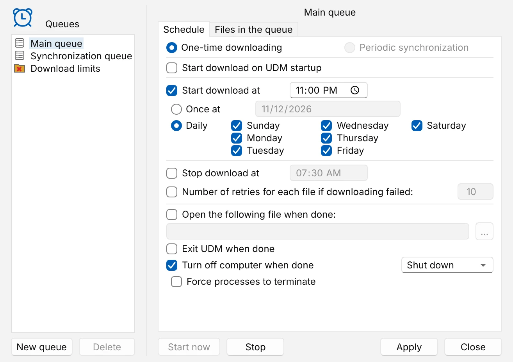

# Download overnight

Collect downloads during the day, let UDM fetch them at night, then put the computer to sleep or
shut it down. This uses the main queue and the Scheduler.

1. **Put the downloads in a queue.** In **Download File Info**, click **Download Later** instead of
   **Start Download**: the download waits in the main queue. In the browser, right-click a link and
   choose **Download later with UDM**. A download already in the list goes in from its right-click
   menu: **Add to queue > Main queue**.
2. **Open the Scheduler**: **Scheduler** in the toolbar, or **Downloads > Scheduler**. Pick **Main
   queue** on the left.
3. **Set the start time.** On the **Schedule** tab, tick **Start download at** and type the time,
   such as 11:00 PM. Choose **Daily** and the days to run on, or **Once at** and a date. To stop
   before you need the connection again, tick **Stop download at** and give a time; one earlier
   than the start means the next morning.
4. **Say what happens after.** Tick **Turn off computer when done** and pick **Shut down**,
   **Sleep** or **Hibernate**, or tick **Exit UDM when done**. **Number of retries for each file if
   downloading failed** tries a failed download again before the queue counts it as done.
5. **Click Apply.** The **Files in the queue** tab shows the queue's downloads in order: the arrow
   buttons (**Move up** and **Move down**) change the order, and **files at the same time** sets how many run at once.

<picture>
  <source media="(prefers-color-scheme: dark)" srcset="../images/scheduler-dark.webp">
  
</picture>

Leave UDM running: closing the window keeps it in the tray, which is enough. **Launch UDM on
startup** in **Options > General** starts it, in the tray, when you sign in. On Windows, UDM also
wakes a sleeping computer for the start time, if the power plan allows wake timers; the Scheduler
says so when it does not.

When the queue is done, UDM counts down for 60 seconds before it turns the computer off.
**Cancel** in that window stops it. **Start now** in the Scheduler runs the queue at once instead of
waiting for the time; **Stop** stops it, and its downloads wait in it with what they already have.

More: [queues and the scheduler](../using-udm.md) in Using UDM (from **Queues** on), and
[how the daemon runs them](../queues-and-scheduler.md).
