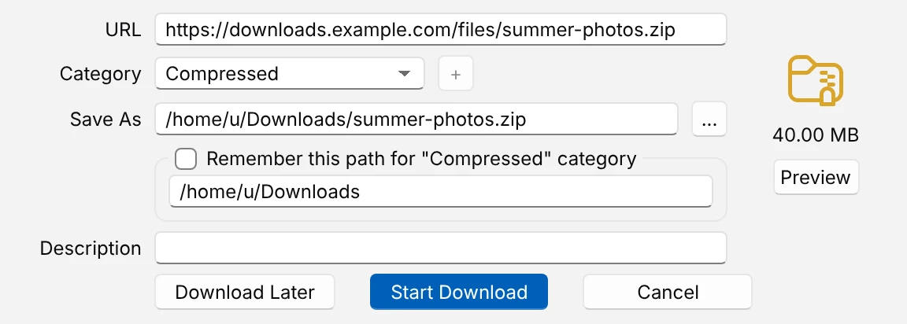
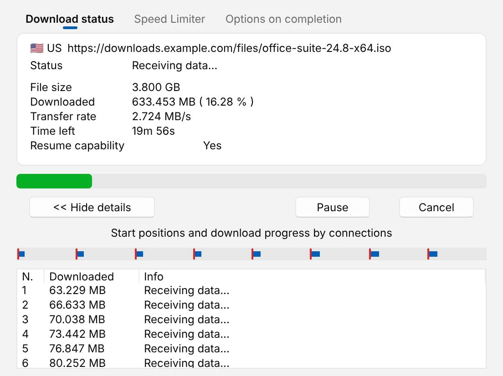

# Your first download

Download one file with UDM, from an address you paste. Takes two minutes.

1. **Install UDM** and start it: from the Start menu on Windows, **Applications** on a Mac, or
   your desktop's app menu on Linux ([Install](../install.md) lists every file). The main window
   opens. If a **Tip of the Day** shows, click **Close**.
2. **Copy the address of a file**, such as a program's download link, from the browser. Right-click
   the link and choose **Copy link address** (the browser's wording may differ).
3. **Click Add URL** in the toolbar (or **Tasks > Add new download**). In **Enter new address to
   download**, paste the address into **Address** and click **OK**. If the site needs a user name
   and password, tick **Use authorization** first and fill them in.
4. **Choose where it goes.** **Download File Info** opens with the file's real name and size. UDM
   picks a **Category** from the file's type, and with it the folder in **Save As**. Change the
   name or the folder (**...** picks another), or keep them, then click **Start Download**.
   **Download Later** keeps it in a queue instead
   ([Download overnight](download-overnight.md)).

   <picture>
     <source media="(prefers-color-scheme: dark)" srcset="../images/save-as-dark.webp">
     
   </picture>

5. **Watch it come in.** The download window shows the size, how much is in, the transfer rate and
   the time left. **Resume capability: Yes** means the server lets UDM fetch the file in parts, so
   it uses several connections and can carry on after a break. **Show details >>** shows what each
   connection is doing. **Pause** stops it and keeps what came; **Cancel** stops it and closes the
   window. Closing this window does not stop the download.

   <picture>
     <source media="(prefers-color-scheme: dark)" srcset="../images/download-dark.webp">
     
   </picture>

6. **Open the file.** When it is done, UDM says so in a notification (on Windows with **Open** and
   **Show in folder**). In the main window, double-click a finished download to open it, or
   right-click it and choose **Open folder**. The **Categories** on the left show only one kind of
   file, or only **Unfinished** or **Finished** downloads.

## Next

- Let the browser hand its downloads to UDM: [Catch browser downloads](catch-browser-downloads.md).
- Closing the window keeps UDM in the tray. **Exit**, in the tray icon's menu or under **Tasks**,
  closes the window; downloads still go on in the background until they are done.
- Everything the main window, the dialogs and Options offer: [Using UDM](../using-udm.md).
