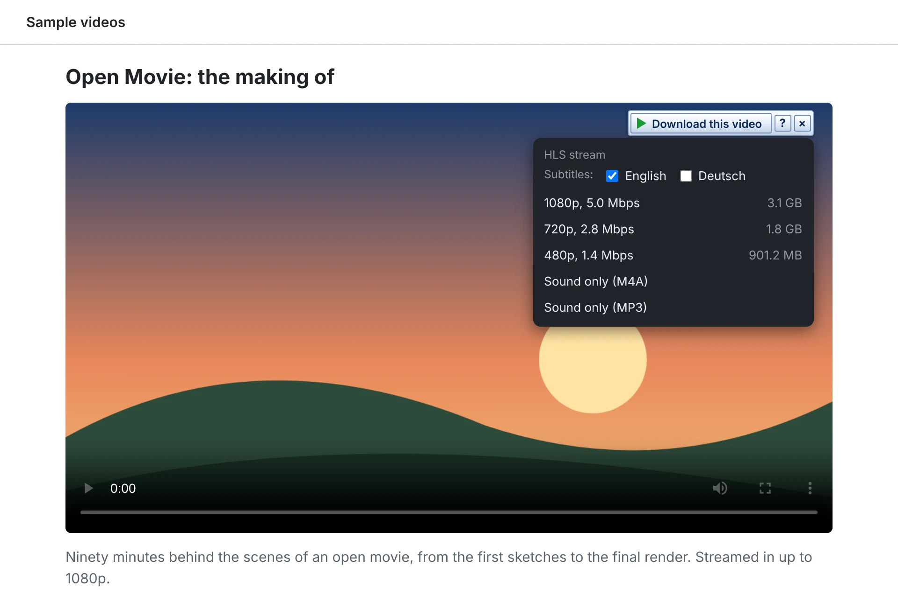

# Download a video from a page

Save a video you are watching in the browser as one file, in the quality you pick.

1. **Install the helpers once.** Streamed videos come in pieces, and UDM joins them into one `.mp4`
   with ffmpeg. YouTube, Facebook, Instagram, Vimeo and many other sites are read with yt-dlp.
   Open **Options > Tools** and click **Install ffmpeg** and **Install yt-dlp**; UDM downloads
   their official builds and checks them. **Keep yt-dlp up to date** keeps up with the sites.
2. **Have the extension connected**, as in [Catch browser downloads](catch-browser-downloads.md).
3. **Play the video.** A **Download this video** bar appears at the top right of the player. Its
   **?** opens the help, and **×** hides it for this video until the page loads again.
4. **Click Download this video** and pick a quality. The list shows what the player loaded: a
   whole video file, or a stream with each quality and about how big it is, and **Sound only** in
   a few formats. Tick the subtitles to keep with it, if the stream has some.

   <picture>
     <source media="(prefers-color-scheme: dark)" srcset="../images/video-dark.webp">
     
   </picture>

5. **UDM takes it from there.** The menu says *Sent to UDM.* and the download goes to UDM like any
   other: **Download File Info** asks where to save it, named after the page's title. UDM fetches
   the stream's pieces over several connections and joins them when they are all in.

## When there is no button, or nothing to pick

- **Right-click the page** and choose **Download the last video with UDM**: it sends the video the
  browser loaded last, in its best quality.
- **A playlist or a channel page** offers **Choose videos**, which lists its videos in UDM to tick.
- **The video is protected (DRM)**: the menu says so and offers nothing. UDM does not get around
  DRM.
- **The button does not show at all**: it may be off for the site, in the popup or in **Options >
  Browser**, under **No video button on**.

More: the video button in [Using UDM](../using-udm.md), and
[streams, batches and the site grabber](../streams-batches-and-grabber.md) for how streams and
video sites are read. In Safari the button may list fewer streams ([Known gaps](../known-gaps.md)).
